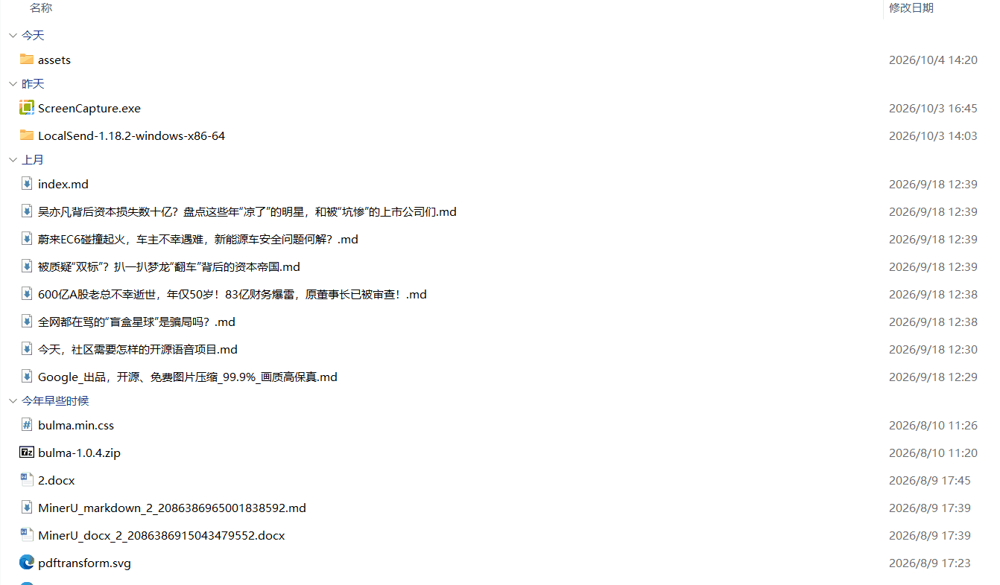

# 文件删除助手

> 文件批量删除/清理脚本，按「 扩展名 / 大小 / 修改时间」条件筛选删除，支持仅预览、送回收站、永久删除三档，可定时自动清理，也可作为节点被其他脚本调用。

---

## 核心特性

- **按条件删除**：不用一个个选中文件，指定文件夹后按扩展名、大小、修改时间自动匹配
- **三档安全方式**：`仅预览`（只列出会被删的文件、一个都不动） / `送回收站`（默认，可从回收站还原） / `永久删除`（不可恢复）
- **多种筛选条件**：扩展名（如 `log,tmp,bak`）、大小范围（`10kb` / `1mb` / `1gb`）、修改时间（早于 / 晚于 / 区间，支持 `day week month year`）、递归子目录、清理空文件夹
- **默认排除关键目录**：`Windows`、`Program Files`、`AppData`、`.git`、`node_modules` 等默认在排除名单里
- **系统目录硬拦截**：盘根目录（如 `D:\`）永远禁止作为清理目标；系统目录根、用户目录根需要显式开启「允许系统目录」才会放行
- **删除结果复核**：逐条复查文件是否真的消失，虚报成功会被单独列出
- **每次留档**：删除清单与释放空间写入日志目录，可回溯
- **可定时**：支持固定间隔 / 每天 / 每周等定时任务，到点自动清理并静默完成
- **可联动**：作为节点脚本被其他脚本调用，回传删除清单、数量、释放空间
- **开源鸣谢：**基于 [deletor](https://github.com/pashkov256/deletor)开发、感谢作者的付出
---

## 脚本演示



> ⚠️ 演示动图待补录：请录制一段「选中文件夹 → 启动脚本 → 填写条件 → 仅预览 → 送回收站」的 5~15 秒操作动图，保存为 `imgs/demo.gif`。

---

## 安装方法

本脚本的运行环境、依赖工具（deletor）及启动窗口均依赖"不忙脚本盒子"，建议仅通过盒子安装和使用本脚本。

> 前置条件：安装好 [不忙脚本盒子](https://www.bm-box.cn)

* 打开盒子 → **脚本市场** → 搜索 **「按条件批量删除文件」**
* 点击「安装」，盒子会自动下载 Python 运行环境与 deletor 命令行工具，无需手动配置

---

## 使用方式

* **直接启动**
  * 在盒子里点击脚本卡片
  * 在弹出的窗口中点「选择文件夹」，可一次添加多个文件夹
  * 选择**方式**（仅预览 / 送回收站 / 永久删除），按需填写扩展名、大小、时间条件
  * 点击「执行」，终端窗口会列出匹配到的文件与处理结果

* **右键启动**
  * 在文件管理器中选中一个或多个**文件夹**，右键 → 选择「文件删除助手」
  * 或在文件夹内空白处右键 → 选择「文件删除助手」（直接清理当前所在的文件夹）
  * 弹出的窗口已自动填好文件夹路径，选方式后执行即可

* **快捷键启动**
  * 为脚本设置全局快捷键，选中文件夹后按下即可弹出启动窗口

**建议流程**：第一次清理某个文件夹时先用 **仅预览**，确认列出的文件是你要删的，再切到 **送回收站**。

---

## 💡 使用提示

* **扩展名**：逗号分隔、不带点，例如 `log,tmp,bak`；留空表示不限扩展名
* **大小**：写法如 `10kb`、`1mb`、`500b`、`2gb`；「最小」是 *大于等于*，「最大」是 *小于等于*
* **时间**：数字 + 单位，如 `30day`（30 天）、`2hour`、`1week`、`6month`；选「早于」即修改时间比这更老的文件
* **递归子目录**：默认开启；关掉只处理该文件夹第一层的文件
* **清理空目录**：仅在送回收站 / 永久删除时可用，会把删完变空的子文件夹一并清掉
* **只删文件、不删目录**：deletor 不会删除仍含有文件的文件夹（要删整个文件夹树请用资源管理器）。若勾了「清理空目录」且目标文件夹里的文件全部命中、被清空，deletor 会连目标文件夹本身一起删掉，脚本会在事后原地重建它
* **排除**：逗号分隔的路径片段，路径中出现这些片段就会被跳过。注意默认名单里含 `AppData`，所以清理 `C:\Users\你\AppData\...` 下的缓存前，需要先把 `AppData` 从排除里去掉
* **允许系统目录**：默认关闭。开启后脚本不再拦截系统目录根（盘根仍然永久禁止），请确认你知道自己在做什么
* **永久删除档**：不经过回收站，删掉就是删掉，请配合「仅预览」确认后使用
* 定时任务与脚本联动**不会弹启动窗口**，直接按你保存的条件执行

---

## 节点脚本(开发者阅读)

本脚本已声明为节点，可通过盒子统一 API `/api/link` 调用。

```python
import requests

resp = requests.post("http://127.0.0.1:9527/api/link", json={
    "script_id": "7f3c1a92-4b6d-4e15-9c8f-2a6d5e7b1c34",
    "data": {"target_dirs": ["D:/Downloads"]},
    "params": {
        "safety": "trash",          # preview | trash | permanent
        "extensions": "log,tmp",
        "size_mode": "on",
        "min_size": "10mb",
        "time_mode": "older",
        "older": "30day",
        "recursive": True
    }
})
env = resp.json()
print(env["code"], env["msg"])
print(env["deleted_files"], env["total_count"], env["freed_size"])
```

返回的业务键（与 `bm-scripts-box-rc.toml` 的 `outputs` 声明一致）：

| 键 | 类型 | 说明 |
| --- | --- | --- |
| `deleted_files` | list | 已删除（`preview` 档为待删除）文件绝对路径；超过 500 条截断，精确数量看 `total_count` |
| `failed_paths` | list | deletor 报成功但复核后仍存在的路径 |
| `skipped_dirs` | list | 被安全拦截或不存在而跳过的目标文件夹 |
| `total_count` | str | 命中文件数量（整数字符串，精确值） |
| `freed_bytes` | str | 释放字节数（整数字符串；`preview` 档为估算值） |
| `freed_size` | str | 人类可读大小，如 `2.00 MB` |
| `safety_mode` | str | 本次实际生效档位 |
| `log_path` | str | 本次 `deletor.json` 日志所在目录 |

---

## 🖥️ 环境要求

| 项目 | 要求 |
| --- | --- |
| **操作系统** | Windows 10+（64 位） |
| **运行环境** | Python >= 3.8（盒子自动准备，无需手动安装） |
| **外部工具** | deletor 2.0.0（盒子通过 `binaries` 自动下载并配置 PATH） |
| **第三方依赖** | 无，脚本仅使用 Python 标准库 |
